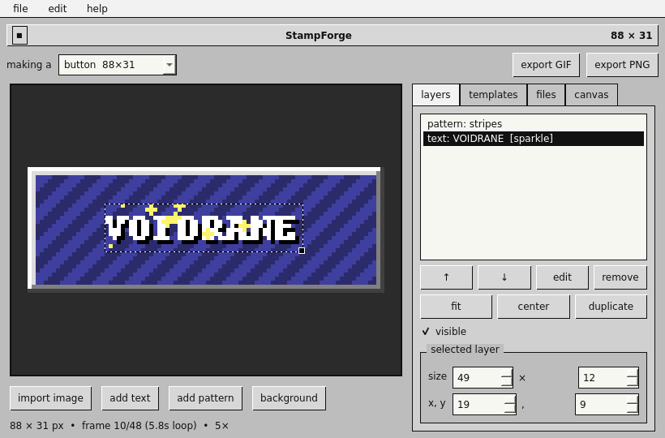

# StampForge



StampForge is a tiny System 7-inspired desktop editor for making 94×50 web stamps, 88×31 / 88×32 buttons, and 150×20 blinkies. It is designed for Neocities, personal homepages, forum signatures, shrine pages, and other small places where a little image says more than a dashboard.

## What it does

- Four canvas formats, picked from the **MAKE A** dropdown or **file → new**: web stamp 94×50, button 88×31, button 88×32, blinkie 150×20. Switching keeps your layers; text and pattern layers re-render at the new size.
- **Quick style presets** for every format: 25 stamp recipes and 30 recipes each for 88×31 buttons, 88×32 buttons, and blinkies. The expanded pack includes grid, diagonal, plaid, noise, polka, sunburst, and halftone textures. Presets add an editable background layer and border, so they are starting points rather than locked themes.
- Draws the true pixel canvas and scales it with nearest-neighbour pixels over a transparency checkerboard.
- Imports PNG, JPG, WEBP, transparent art, and animated GIFs as layers. Resizes always start from the original pixels, so repeated resizing doesn't blur.
- **Text tool** with crisp (non-antialiased) pixel fonts, outline, drop shadow, and blinkie effects: blink, flash between two colours, colour cycle, rainbow, sparkle. Motions: scroll left, scroll right, wave. Double-click a text layer to edit it later.
- **Pattern backgrounds**: solid, gradients, stripes (animated barber-pole), checker, glitter, scanlines, dots, twinkling stars, grids, diagonals, plaid, noise, polka, sunburst, and halftone.
- **Borders** for every format, including stamp-focused dashed, dotted, postage, inset line, pixel corners, shadow frame, and neon frame treatments, plus solid, double, raised bevel, and sunken bevel.
- Adjustable frame delay. The animation length is worked out automatically from all the layers so loops stay seamless.
- Per-format templates: `templates/` (stamps), `templates/buttons/`, `templates/blinkies/`. **Crop to selected template** uses a template's transparent edge or outer paper as the final shape.
- Button and blinkie folders include built-in starter PNGs generated from the style recipes. **Crop to selected template** keeps thin stamp frames, removes large opaque paper gutters, and preserves transparent template edges.
- Files tab browses your image folders. **add folder…** remembers any folder (saved in `~/.config/stampforge/config.json`).
- Exports GIF with a shared palette and real transparency, or a single-frame PNG, at the exact format size.

## Controls

Double-click any thumbnail to add it as a layer. Drag inside the selected layer in the preview to move it, and drag its corner square to resize it. **fit**, **center**, and **duplicate** sit under the layer list. The size and x/y boxes stay in sync for precise edits. Use the **canvas → quick style presets** panel for a fast retro-web background and border, then edit the generated background layer like any other pattern.

Shortcuts: `Ctrl+Z` undo, `Ctrl+R` / `Ctrl+Shift+Z` redo, `Ctrl+I` import image, `Ctrl+T` add text, `Ctrl+P` add pattern, `Ctrl+E` export GIF, `Ctrl+Shift+E` export PNG, `Enter` edit layer, `Delete` remove layer.

File and colour dialogs use StampForge's own light theme, so they stay readable under dark KDE colour schemes.

## Run it

```sh
python /home/scorn/stampforge/stampforge.py
```

The application launcher is installed at `~/.local/share/applications/stampforge.desktop` and appears under **Graphics → StampForge**.

## Local asset folders

The app's own reusable files live in `/home/scorn/stampforge/files/` and its templates live in `/home/scorn/stampforge/templates/`. Button and blinkie templates live in `templates/buttons/` and `templates/blinkies/`. Imported assets are copied there; originals are never modified.

## Requirements

Python 3, PySide6, and Pillow. On this workstation those are already installed system-wide.
